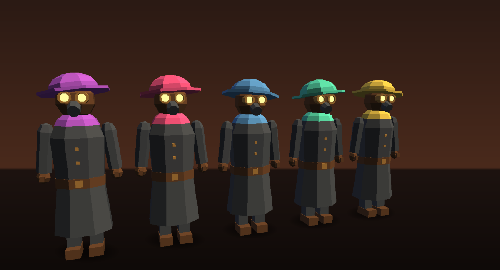
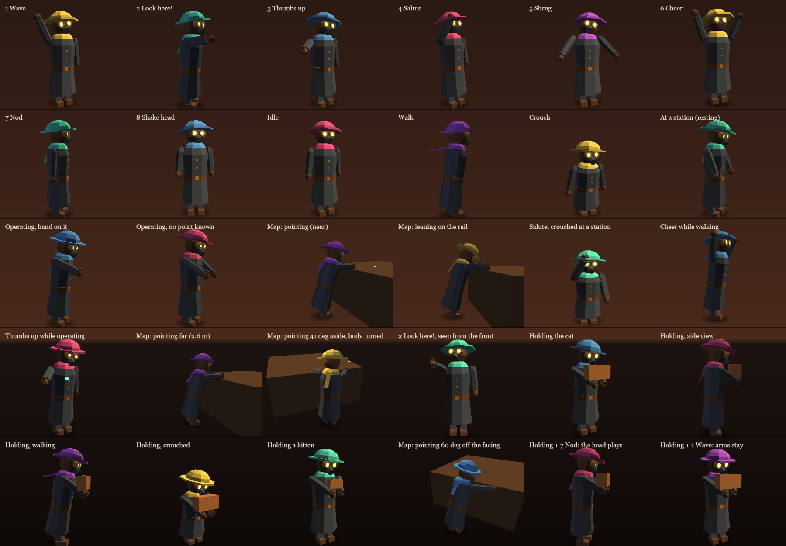
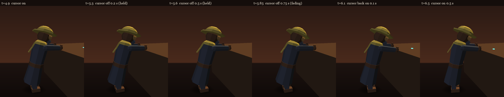
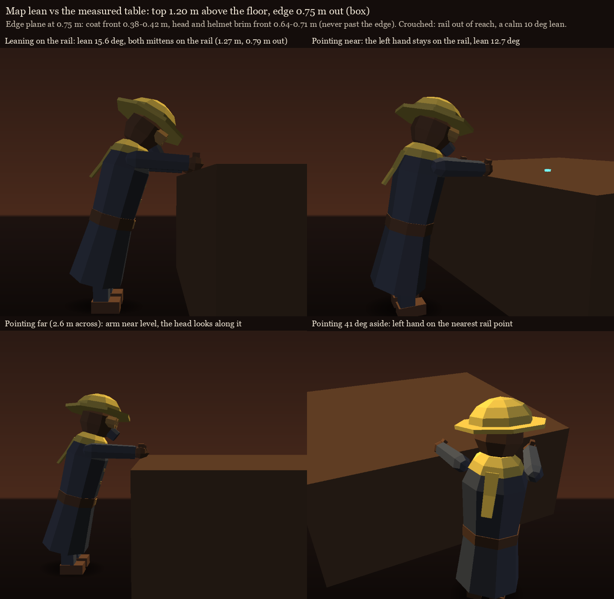
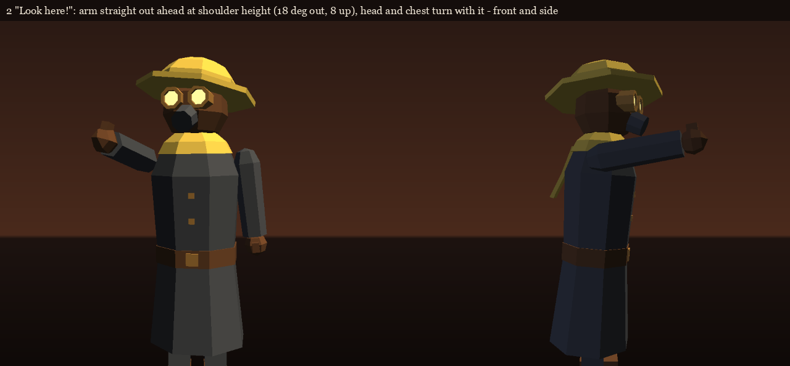
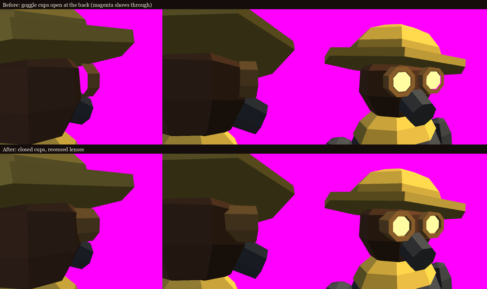

# Crew figure (remote player avatar)

How other players look to you in co-op. The figure is built in code from our own low-poly shapes.
There are no downloaded models or textures, so it stays MIT and adds no dependencies.



Open [preview.html](preview.html) in a browser to orbit the figure, try its poses and press 1-8 for
the emotes. It uses the same geometry as the game. `preview.html#sheet` shows every pose and emote
at once:



## What it looks like

A chunky WW1 turret crew member, matching the poster silhouettes of the mod's branding:

- **Helmet** in the player's colour: a low Brodie dome on a wide brim. Each player's helmet sits
  at its own slight tilt.
- **Gas-mask hood** in leather, with two round **brass goggle cups** whose recessed lenses glow
  warm. It also has a stubby filter snout.
- **Scarf** in the player's colour, wrapped round the neck. Its loose end hangs down the back, so you
  can tell who is who from behind.
- **Greatcoat** in slate grey, with a leather belt, a brass buckle and two buttons.
- Sleeves with leather mittens (with a thumb, for the thumbs-up), and short legs with boots.
- The head is drawn 1.2x for a friendly, slightly toy-like proportion.

## What moves, and from what

Everything is driven by the `AvatarState` message (`AvatarModel.Pose`), plus the figure's own motion
between messages.

| Part | Motion | Driven by |
|---|---|---|
| Whole body | breathing (slow rise and fall), squash when crouching | time, `Crouch` |
| Hips | bob and waddle while walking; lean into the walk, into turns, when looking down, over the map table and towards what they hold | speed measured from the parent's motion, yaw rate, `Pitch`, `AtMap`, `Operating` |
| Legs | swing on the walk cycle; shorten in the crouch | speed (the cycle advances by distance walked) |
| Head | follows the camera pitch; leads turns; an occasional curious tilt; glances around after ~5 s standing still | `Pitch`, yaw rate, time |
| Helmet | small jiggle on the walk | walk cycle |
| Goggle lenses | blink every 2-6 s (sometimes twice); squint while operating or at the map, a little at a station | time, station |
| Arms | swing opposite the legs | speed |
| Arms at a station | rest forward on the console, calm | `AtConsole` without `Operating` |
| Arms while operating | the hand on that side reaches for the held point, turning a small working circle; both hands when it's in front of them; hands forward and busy when the point isn't known | `Operating`, `HasReach`, `Reach` |
| Arms at the map | hands on the table rail; the right hand points at the cursor while the head looks there and the chest turns a little | `AtMap`, `HasPoint`, `Point`, `TableTopY`, `TableAcross` |
| Arms carrying the cat | both hands forward and together at the waist, a cradle over every other arm pose | `Holding` |
| Scarf end | trails behind on a springy lag, swings out on turns and strafes, flutters | speed, sideways speed, yaw rate |

How the operating and map poses work:

- **Operating:** when the held point is beside the shoulder, the arm passes slightly through it. A
  single-bone arm can only aim, it can't bend. The reach point is smoothed, and a new grip far away
  starts at the new spot.
- **Map pointer:** it comes and goes as the cursor crosses the table edge. The figure keeps pointing
  at the last spot for 0.6 s, then eases back to the leaning pose:

  

- **The map table** as measured in game: the top is 1.20 m above the floor, and the figure stands
  0.75 m from the edge.
  - **Pose fields:** `Pose.TableTopY` gives the top in world y. NaN, or anything implausible, falls
    back to 1.20 m above the feet. `Pose.TableAcross` gives which way is across the table; zero means
    straight ahead.
  - **Hands:** each mitten rests on the rail point nearest its shoulder. A hand that can't reach the
    rail, for example when the body is turned well aside, hangs relaxed instead.
  - **Lean:** the arm is only 0.5 m, so the figure leans just enough for the resting hand to reach,
    about 13-16° with the shoulders 6 cm forward. The lean is solved every frame. Crouched, the rail
    is out of reach, so it keeps a calm 10°.
  - **Edge plane:** nothing crosses it. The coat front stays at 0.38-0.43 m and the head and helmet
    brim at 0.64-0.71 m, with the edge at 0.75 m (measured in the preview with `#checkmap`).
  - **Pointing:** the right arm aims straight at the cursor, up to 2.6 m across and 60° off the
    facing. The left hand stays on the rail.

  

### Holding the cat

`Pose.Holding` puts both arms in a cradle. It blends in and out over about 0.25 s, and stays on
while walking, crouching or at a station. Emotes still play their head and body parts (a nod, a
hop), but not their arm parts.

`TryGetHoldPoint(out pos, out rot)` says where the cat lies, in world space, while the cradle is
mostly blended in:
- `pos` is the resting point on top of the forearms, centred between the hands. The cat's underside
  goes there.
- `rot` lays the cat across the arms: its forward is the figure's right, and its up is world up.

The pose was searched against the real coat cross-sections (8-sided, with belt and collar):

| Check | Result |
|---|---|
| Hands | about 1.1 m high, 0.45 m in front; arms 28° below level |
| Shoulders | come 6 cm forward (a small hunch) |
| Forearms under the cat | 22 cm apart: a kitten (27 cm) bridges them, a grown cat (45 cm) drapes over both |
| Cat vs chest | the cat's back clears the coat by 10-14 cm |
| Cat vs face | the top of a grown cat stays below the mask (about 1.46 m standing) |
| Sleeve vs coat | 1.3 cm in at most, only where the upper arm meets the shoulder (the hanging arm is 2.2 cm in there) |

The hold point's world conversion was checked in the preview: a verbatim copy of the C# formula
matches the matrix result to 0 mm while walking and turning (`preview.html#checkhold`). The contact
sheet shows the cradle with a box standing in for the cat.

Quirks are seeded by the player's slot: helmet tilt, breathing phase, shrug tilt, and when blinks
and tilts come. The five crew members don't move in sync.

### Emotes

`Emote(id)` plays one; `EmoteNames[id]` is its HUD label; `Emoting` says one is playing. A new
emote replaces a running one. Each has an eased in and out, and the last stage of the animation
smooths the arm and neck rotations, so a switch never snaps. Emotes are layered on top of whatever
the figure is doing: walking, crouching, at a station, operating or at the map. Only the parts an
emote uses are taken over.

| Id | Name | What it does | Length |
|---|---|---|---|
| 1 | Wave | right hand up and wagging, head tips towards it. Also plays once on arrival. | 1.8 s |
| 2 | Look here! | right arm straight out ahead at shoulder height (18° out so it reads from the front, 8° up), jabbed forward twice; the head and chest turn with it | 1.7 s |
| 3 | Thumbs up | right arm out front-side at chest height, thumb up, a little pump, cheeky head tilt | 1.6 s |
| 4 | Salute | snaps the right hand to the helmet brim and stands up straight | 1.6 s |
| 5 | Shrug | both hands out, shoulders up, head tilted | 1.6 s |
| 6 | Cheer | both arms up and pumping, little hops (smaller when crouched), looks up, eyes wide | 2.0 s |
| 7 | Nod | three nods yes | 1.3 s |
| 8 | Shake head | shakes no, eyes narrowed | 1.4 s |



## Code

- `src/IronNestCoop/Sync/AvatarGeometry.cs` holds the shapes as plain numbers, with no Unity types.
  They are low-poly lathes, strips and boxes, flat shaded: each triangle has its own vertices and the
  face normal. This file also holds the colours and the rig pivots.
- `src/IronNestCoop/Sync/AvatarModel.cs` holds the Unity side:
  - `Build(parent, color, baseMat, seed)` builds the figure.
  - `Animate(dt, pose)` runs every frame.
  - `Emote(id)`, `EmoteNames` and `Emoting` handle emotes.
  - `TryGetHoldPoint` says where a carried cat lies.
  - `SetColor`, `Wave`, `Dispose`, plus `Head`, `Body`, `Renderers` and `TagHeight` for the
    caller.
- `tools/avatar-preview` is a small console app that writes `docs/avatar/geometry.js` from
  `AvatarGeometry.cs`, for the preview. Run it from the repo root:
  `dotnet run --project tools/avatar-preview`.
- The motion in `preview.html` is a hand port of `AvatarModel.Animate`. If you change the motion,
  change both.
- The preview draws with its own small depth-buffered rasteriser, so overlaps sort per pixel as
  they do on the GPU.
- The hash options of `preview.html` are listed at the top of the file. For example,
  `#mode=station+crouch&emote=4` shows a salute while crouched at a station.

Hierarchy under the avatar root:

```
Nestmates figure / Rig (bob, hops)
  Leg L, Leg R                       (hip pivots)
  Hips (lean, waddle)
    Coat (squash)                    Arm L, Arm R (shoulder pivots)   Scarf (end of the scarf)
    Neck (look, nod, shake) / Head (x1.2) / Helmet, Eyes
```

### Closed shapes

Every shape is a closed shell: each edge is shared by exactly two triangles, in opposite
directions. So no part can be seen through from any angle. The goggle lenses are the one
exception: flat discs set into closed cups. This was checked by counting unshared edges per part
(all 0 except the lenses), and by checking that each part's signed volume is positive, which means
no shell is inside out.

An earlier version had open goggle rims that could be seen through from the side and back.
Smaller openings were also closed: the belt band, the underside of the scarf collar, the base of
the filter snout, and the seam between the helmet's dome and brim. Before and after, against a
magenta background:



## Performance

- 768 triangles and 9 mesh renderers per figure. Five players come to about 3.8k triangles.
- Meshes are built once and shared by every figure. Four materials are shared: coat, leather, brass
  and glow (emissive). Each figure owns one more material, its colour.
  - The shared assets are marked `DontUnloadUnusedAsset`, and are rebuilt if Unity ever destroys
    them anyway.
  - `Dispose()` frees the figure's own material.
- The goggle lenses cast no shadow. No colliders, no physics, no skinning, no Animator.
- `Animate` allocates nothing. It reads `parent.position` and `parent.eulerAngles` once per frame,
  then writes 20 local transform values.
  - All quaternion and vector maths, including the reach and point aiming, is done in managed
    code on struct fields. Under Il2CppInterop, calls like `Quaternion.Euler`, `Slerp` and the
    `Vector3` constructor go through the IL2CPP bridge.
  - The maths was checked against `System.Numerics`, which uses Unity's z-x-y Euler order.
- Materials start from the mod's URP Lit base material. Copied textures are cleared, so a material
  copied from the scene can't bleed its texture onto the figure.
